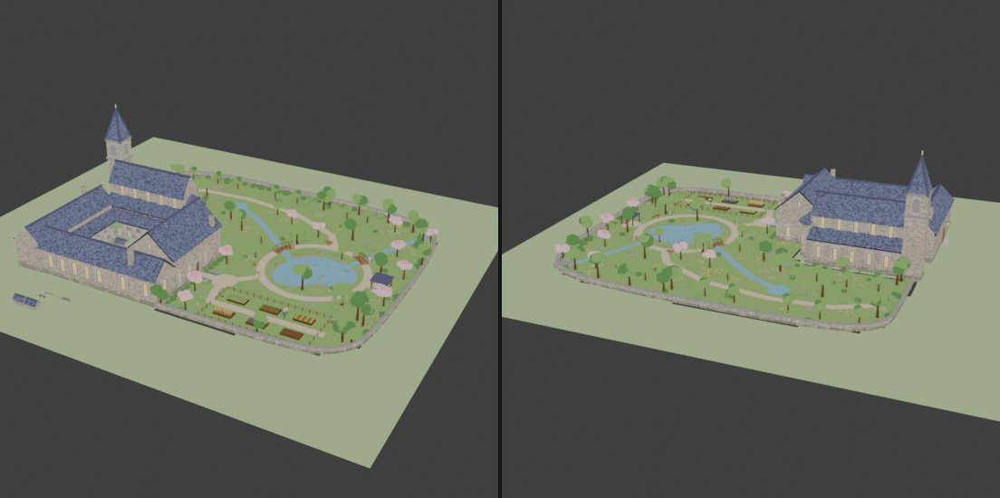
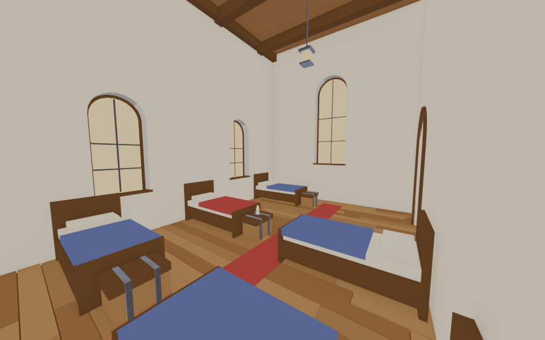
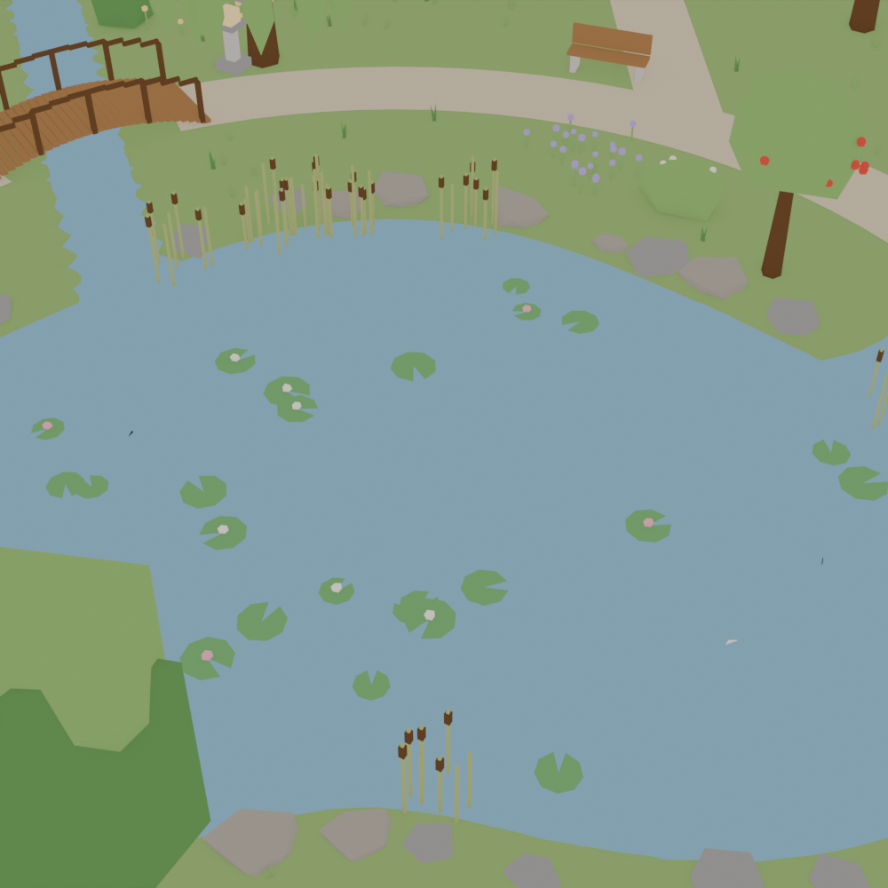
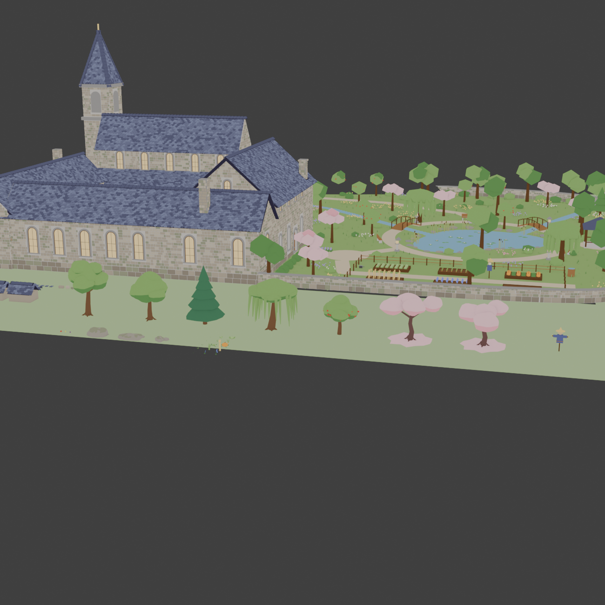
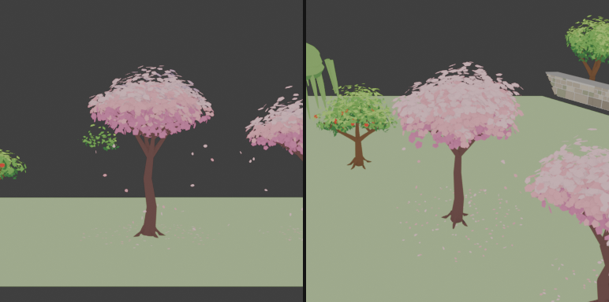
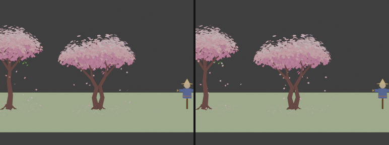
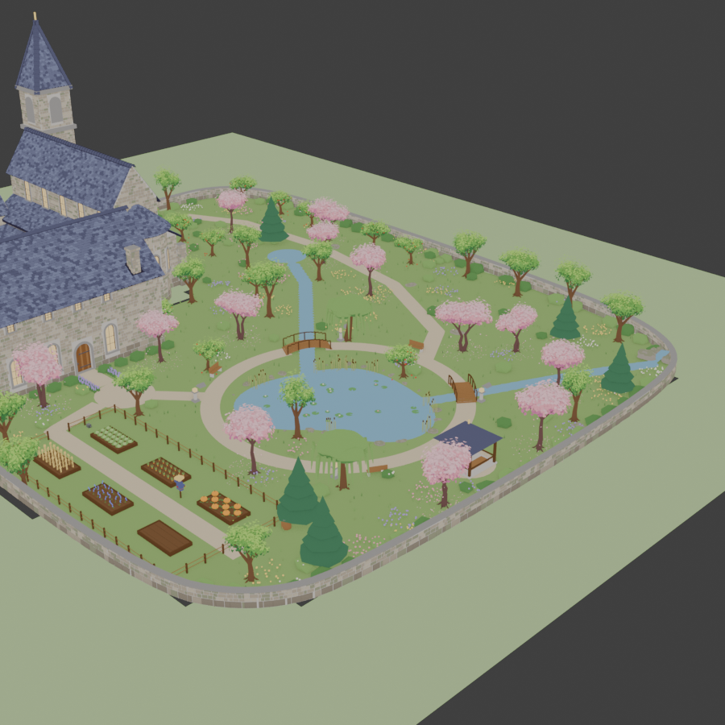

# Monastery of Greyhaven – Blender-asset

> Gebouwd in Blender met Claude op 2026-10-12. Bestand: `C:\Users\Bo\Documents\Morvath\Greyhaven\assets\Monastery.blend`
> (backups: `Monastery_backup_before_tiles`, `_before_interior`, `_before_garden`). Scripts: `tools/blender/monastery/`.
> Staat nog **niet** in Greyhaven: dat gebeurt (zoals bij de smidse) in de aparte Greyhaven-chat.

## Opbouw (zoals een echt middeleeuws klooster, naar het St. Gall-plan)

| Deel | Plek (lokaal, +Y = noord) | Wat |
|---|---|---|
| Kerk | noord, x −12…14 | Middenschip + zijbeuken, ronde apsis (oost), poort + roosvenster (west), klokkentoren met spits (NW) |
| Kloostergang | midden, 20 × 20 m | Overdekte gangen met rondbogen, binnentuin met kruidenbedden, waterput, lantaarns |
| Oostvleugel | x 10…22, y −10…10 | **Van binnen speelbaar**: hal + 6 kamers (zie hieronder) |
| Eetzaal (Refectory) | zuid, x −10,6…22 | Loopt door tot de oostmuur, zodat de hoek dicht is |
| Westvleugel | west | Voorraad/gasten, grote poort naar buiten |
| **Monastery Garden** | oost + achter de kerk | Vredige tuin met vijver, beekjes, moestuin (zie hieronder) |

## Daken en muren

- **Leien:** 4 vormen (A recht, B visschub, C punt, D afgebroken hoek) in 3 tinten, rijen half over elkaar en verspringend,
  elke rij precies passend tussen de dakranden. Spits vooral visschubben.
- **Nok- en graatpannen:** E (hoekig) en F (rond, op de kerk). 0,6 m lang, om de 0,5 m: de brede voorkant valt over de
  smalle, lagere achterkant van de volgende, dus de naden lopen strak over.
- **Muurstenen:** A, B, C (gewone muur) en de grote funderingsstenen D, E in de onderste 1,2 m. Alleen de zichtbare
  voorkant van een steen is gemodelleerd (8 vertices), rond ramen en deuren wordt ruimte gelaten.
- Ramen: stenen boog, vensterbank, houten kozijn, glas in lood (warm gloeiend). Deuren: planken, ijzeren banden, ringgreep.

## Oostvleugel – binnen

12 m breed, muren 0,6 m dik, plankenvloer, plafond op 6,5 m met donkere balken. Ingang vanuit de kloostergang, een
tweede deur aan de oostkant gaat de tuin in.

| Room | Wat erin staat |
|---|---|
| Hall | gang met banken en lantaarns, deuren naar kloostergang en tuin |
| Dormitory | 5 bedden met kisten; **bed met rode deken = speler** (`MON_Spawn_PlayerBed`) |
| Infirmary | 2 bedden, kruidenrek, tafel |
| Warming Room | open haard + schoorsteen, banken, kleed |
| Chapter House | stenen banken langs de muren, stoel van de abt, lessenaar |
| Scriptorium | schrijftafels bij het raam, boekenkast |
| Brother Ansel's Cell | bed, bureau, kist (`MON_NPC_BrotherAnsel`) |

## Monastery Garden

Ongeveer twee keer de oppervlakte van het klooster, in de vorm die Bo tekende: van de zuidoosthoek langs de hele
oostkant en achter de kerk langs tot de toren, met een lage stenen muur eromheen. Je komt erin via de oostdeur van de hal.

- **Vijver** (midden-oost) met een grindpad eromheen, waterlelies, riet, rotsen, 2 treurwilgen, 4 stenen lantaarns,
  bankjes en een prieel aan de oostkant.
- **Beekje** uit een bronnetje met watervalletje (noordoost) de vijver in; aan de andere kant stroomt het achter de kerk
  langs naar een poel. Twee houten bruggetjes waar het pad het water kruist.
- **Koi:** voor nu weggehaald (2026-10-12, Bo). De kleuren `GH_Monastery_Koi_White/Black` blijven bewaard in het .blend.
- **Groen:** boomgaard achter de kerk, bloesembomen, loofbomen en dennen, struiken, bloemenvelden, lavendel langs het pad.
- **Moestuin met kweekbare bedden** (met hekje, vogelverschrikker, regenton):

| Marker | Gewas nu |
|---|---|
| `MON_FarmPlot_1` | Cabbage |
| `MON_FarmPlot_2` | Carrot |
| `MON_FarmPlot_3` | Pumpkin |
| `MON_FarmPlot_4` | Wheat |
| `MON_FarmPlot_5` | Moonbell (magisch kruid, magieblauw) |
| `MON_FarmPlot_6` | Empty (omgespit, klaar om te planten) |

Elke marker heeft de eigenschappen `crop` en `farmable = true`.

## Losse tuinmodellen (collectie `MON_GardenPieces`)

Net als de leien en stenen zijn alle tuinonderdelen losse modellen; de tuin gebruikt **instances** (gedeelde mesh) ervan.
Pas je een model aan, dan verandert elk exemplaar in de tuin mee. Bomen in de tuin heten `GH_Tree_MON_<soort>_<nr>`,
zodat de web-export ze als bomen herkent (zoals de `GH_Tree*`-nodes in Greyhaven).

| Groep | Modellen (`GH_Monastery_…`) |
|---|---|
| Bomen | `Tree_Oak_A`, `Tree_Oak_B`, `Tree_Pine`, `Tree_Willow`, `Tree_Apple` (met appels), `Tree_Sakura_A`, `Tree_Sakura_B` (met afgevallen bloesem) |
| Rotsen | `Rock_A` (kei), `Rock_B` (platte steen), `Rock_C` (groepje), met mos bovenop |
| Fruit | `Fruit_Apple`, `Fruit_Pear`, `Fruit_Plum` |
| Gewassen, 3 groeistadia | `Crop_<Cabbage/Carrot/Pumpkin/Wheat/Moonbell>_1_Seedling`, `_2_Growing`, `_3_Ripe` |
| Overig | `Scarecrow` |

In de tuin: 47 bomen, 39 rotsen, 94 gewassen (rijp), de vogelverschrikker en afgevallen appels onder de appelbomen.
De kweekbedden `MON_FarmPlot_1…6` hebben nu ook `stage` (0 = leeg, 3 = rijp). Script: `tools/blender/monastery/05_garden_pieces.py`.

**Sakura's (2026-10-12):** de kroon is een takkenstelsel (stam → dikke takken → takken → twijgen) met losse
bloesemtrosjes, zodat je de takken door de bloesem heen ziet. Onder de boom liggen losse blaadjes.
**Vallende blaadjes:** per sakura een *collection instance* van `MON_PetalFall_Sakura_A/B` (28 blaadjes, lus van 240
frames = 10 s, draaien en zweven met de wind mee, verdwijnen als ze landen). In de tuin staan ze in `MON_Garden_PetalFalls`,
op dezelfde plek, draaiing en grootte als de boom. Of de glTF-export deze animatie meeneemt moet nog getest worden;
anders kan de game de blaadjes zelf laten vallen vanaf de boomposities (goedkoop met één InstancedMesh).

**Bomen in Genshin-stijl (2026-10-12, naar Bo's voorbeelden):** de sakura's, eiken en de appelboom hebben nu een
kroon van heel veel kleine losse kaartjes (bloesem: bloemetje met 5 punten, blad: puntig ovaal) in trosjes en grote
wolken. Bovenkant en buitenkant zijn licht, binnen en onder donkerder, zodat de kroon in lagen lijkt te liggen.
Slanke, vertakte stammen; `Tree_Sakura_B` heeft twee stammen die om elkaar heen draaien. Tussen de wolken door zie je
nog takken. Nieuwe kleuren: `GH_Monastery_Blossom_Deep`, `GH_Monastery_TreeLeaf_Light/Mid/Deep`.
De vallende blaadjes beginnen nu in de nieuwe kroon. Script: `tools/blender/monastery/06_card_trees.py`
(backup ervoor: `Monastery_backup_before_card_trees.blend`).

| Model | Vertices |
|---|---|
| `Tree_Sakura_A` / `_B` | ~27.000 / ~26.000 |
| `Tree_Oak_A` / `_B` | ~11.000 / ~12.600 |
| `Tree_Apple` | ~8.000 |

Dat is zwaar per boom; omdat het instances zijn kost het geheugen weinig, maar voor de game is een lichtere versie
(minder kaartjes of een LOD voor verre bomen) slim.

## Markers (collectie `MON_Markers`)

`MON_Spawn_PlayerBed`, `MON_NPC_BrotherAnsel`, `MON_Door_Cloister_Outside`, `MON_Door_East_Outside`,
`MON_Room_<naam>` (midden van elke kamer), `MON_FarmPlot_1…6`.

## Grootte (vertices)

| Collectie | Vertices |
|---|---|
| Daken (`MON_RoofTiles`) | ~277.000 |
| Muurstenen (`MON_WallStones`, incl. tuinmuur) | ~166.000 |
| Tuin (`MON_Garden`) | ~78.000 |
| Gebouw + ramen/deuren (`Monastery`) | ~20.000 |
| Meubels (`MON_Interior`) | ~2.600 |

Dat is veel meer dan de smidse (~13.000). Vóór het in Greyhaven gaat is een optimalisatiestap slim (net als bij de smidse),
vooral voor daken die je alleen van ver ziet.

## Tijdelijke namen

**Monastery Garden** en **Moonbell** zijn werktitels; nog niet definitief.
