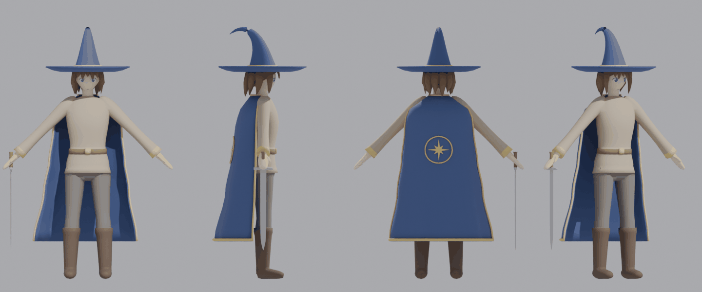

# Personage – Blender-scripts (Fase A)

Bron: `Greyhaven.blend` (staat niet in de repo; Bo heeft hem lokaal), collectie `StartCharacter`.
`00_build_character.py` verandert de scène (daarna zelf opslaan); `01_prep_mixamo.py` laat de scène
zoals hij was en slaat het .blend-bestand nooit op.

| Bestand | Chat | Wat |
|---|---|---|
| `00_build_character.py` | voorbereiding | Het echte startpersonage maken in `StartCharacter` (het oude poppetje gaat naar een verborgen collectie) |
| `01_prep_mixamo.py` | 1 | Lijf klaarmaken voor Mixamo → `body_for_mixamo.fbx` |
| `02_import_mixamo.py` | 2 | (komt nog) Mixamo-rig + animaties terug in Blender, cape-botten, export naar `player.glb` |

**Mixamo-licentie:** de bestanden uit Mixamo (en `body_for_mixamo.fbx`) gaan **nooit** in git.
Ze staan in de map `Mixamo` naast `Greyhaven.blend` (buiten de repo) of in `art-source/` (in `.gitignore`). Alleen de
uiteindelijke `public/zones/greyhaven/player.glb` gaat in git.

---

## Eerst: het echte personage maken – `00_build_character.py`

Besluit 2026-10-13: eerst de looks, daarna Mixamo. Lengte: **1,70 m** zonder hoed (stijlgids, gekozen door Bo).



*(Voorbeeld uit een test-render zonder cel-shading en omlijning; die doet de game.)*

**Draaien in Blender:**
1. Open `Greyhaven.blend`. Bewaar eerst een kopie van het bestand (voor de zekerheid).
2. Tabblad **Scripting** → **New** → plak `tools/blender/character/00_build_character.py`
   (op GitHub: **Copy raw file**) → klik op **▶** (Run Script). Het duurt een paar seconden.
3. Er verschijnt een melding met de lengte en het aantal driehoeken. Bij een fout staat de
   reden in de melding en in `Mixamo\log_build.txt` (naast `Greyhaven.blend`).
4. Kijk in de Viewport (bijv. numpad 1, 3 en 7). Tevreden? **Opslaan met Ctrl+S.** Niet tevreden?
   Niet opslaan en het bestand opnieuw openen; dan is alles weer zoals het was.

**Zonder venster:** `blender -b Greyhaven.blend --python tools/blender/character/00_build_character.py -- --save`

Wat het script doet:
- Het oude poppetje (losse cilinders en bolletjes) gaat naar de verborgen collectie
  **`StartCharacter_Old`**, met `_Old` achter elke naam. Niets wordt weggegooid.
- Het nieuwe personage komt in **`StartCharacter`**, op de plek van de empty `Player` en met dezelfde
  kijkrichting (en, als de oude stukken aan `Player` hingen, ook aan `Player`).
- **`Body`**: romp, nek, hoofd, armen, handen, benen en laarzen als **één gesloten mesh**, armen in
  A-pose (45°), handen los van het lijf, benen iets uit elkaar, extra ringen bij schouders,
  ellebogen, polsen, heupen, knieën, enkels en langs de rug/buik.
- Losse objecten: `Hair`, `Face` (ogen en mond; hangt straks net als het haar aan het hoofdbot),
  `Hat`, `Hat_Band`, `Hat_Brim`, `Cloak`, `Cloak_Trim` (gouden zoom + kompasster op de rug),
  `Collar_Trim`, `Sword_Blade`, `Sword_Grip`, `Sword_Guard` (in de rechterhand).
- Materialen: `Skin`, `Hair`, `Cloak_Navy`, `Hat_Navy`, `Gold_Trim` (de character creator kleurt
  die), `Tunic`, `Pants`, `Leather`, `Boots`, `Old_Steel`, en `Outline` als omlijning (een Solidify
  met omgedraaide normalen, zoals bij het oude poppetje). Nieuw: `Eye_White`, `Eye`, `Eye_Line`
  voor het gezicht. Bestaat een materiaal al, dan gebruikt het script dat.
- Driehoeken (met de omlijning meegeteld): lijf + haar + mantel ±15.500, alles samen ±20.000.
  Zonder omlijning is dat ±7.700 en ±10.000.

Let op:
- **Nog een keer draaien** bouwt het nieuwe personage opnieuw op dezelfde plek. Wat je er met de
  hand aan veranderd hebt, is dan weg. Het oude poppetje blijft in `StartCharacter_Old`.
- Wil je iets anders (lengte, hoed, mouwen, ...)? De getallen staan bovenaan en per onderdeel in
  het script (`HEIGHT`, `ARM_ANGLE`, `CLOAK`, ...); zeg het in de chat, dan pas ik het aan.
- `export_web.py` en de game zijn nog niet aangepast: `player.glb` opnieuw exporteren doen we pas na
  Chat 2. Tot dan staat in de game het oude poppetje.

---

## Deel A – `01_prep_mixamo.py` draaien (Chat 1)

**In Blender (makkelijkst):**
1. Open `Greyhaven.blend` in Blender zoals altijd.
2. Klik bovenin op het tabblad **Scripting**.
3. Klik in het tekstvak op **New**.
4. Open op GitHub `tools/blender/character/01_prep_mixamo.py`, klik rechtsboven op **Copy raw file**
   (het icoontje met de twee blaadjes) en plak het in Blender (Ctrl+V).
5. Klik op **▶** (Run Script). Na een paar seconden is hij klaar.
6. Naast `Greyhaven.blend` staat nu een map **`Mixamo`** met `body_for_mixamo.fbx`.

Het script verandert niets aan je scène. Opslaan hoeft niet, maar het kan ook geen kwaad.
Gaat er iets mis? Kijk in *Window → Toggle System Console* of stuur `Mixamo\log_prep.txt`.

**Zonder venster (voor wie dat wil):**
`blender -b Greyhaven.blend --python tools/blender/character/01_prep_mixamo.py -- <uitvoermap>`

Wat het script doet:
- Kopieert het lijf `Body` (gemaakt door `00_build_character.py`; al in A-pose en met ringen).
  Haar, gezicht, hoed, cape, kraag en zwaard blijven eruit (die komen in Chat 2 terug). De zwarte
  omlijning (`Outline`) ook.
- Draait het lijf met het gezicht naar Blender −Y (de voorkant voor Mixamo), voeten op 0, in het midden.
- (Voor een lijf van losse stukken kan het ook de stukken samenvoegen, ringen snijden en de armen
  in A-pose zetten: zie `BODY`, `RINGS` en `ARMS` in het script.)

Wat eruit komt (in de uitvoermap):
- `body_for_mixamo.fbx` – dit upload je naar Mixamo.
- `prep_info.json` – wat er gedraaid en verschoven is (Chat 2 gebruikt dit om alles weer recht te zetten).
- `log_prep.txt` – maten, aantal driehoeken, materialen. Bij een fout staat hier waar het misging.

Controle (optioneel): open een leeg Blender, *File → Import → FBX*, kies `body_for_mixamo.fbx`.
Je ziet één poppetje zonder hoed/haar/cape/gezicht, armen schuin naar beneden, voeten op de grond.

---

## Deel B – Mixamo (Bo, met de hand)

1. Ga naar [mixamo.com](https://www.mixamo.com) en log in (gratis Adobe-account).
2. **Upload Character** → kies `body_for_mixamo.fbx`.
   - Staat het poppetje met zijn rug naar je toe of ligt het? Draai het in de eerste stap met
     de draai-knoppen tot je het van voren ziet, en klik dan *Next*.
3. **Auto-Rigger:** sleep de bolletjes naar kin, polsen, ellebogen, knieën en kruis.
   - *Skeleton LOD*: **No Fingers** (de handen zijn wantjes, vingers zijn niet nodig).
   - Klik *Next* en kijk in de preview of de armen en benen netjes buigen (geen rare uitrekkingen).
     Dat is meteen de Definition of Done van Chat 1: lukt dit, laat het weten.
4. **Gerigd poppetje downloaden:** zonder animatie (*T-Pose*), *Format: FBX Binary*,
   *Skin: With Skin*. Sla op als **`body_rigged.fbx`**.
5. **Animaties downloaden**, met jouw poppetje geselecteerd (dan passen ze op jouw skelet):
   - Vink **In Place** aan als die optie er is.
   - Zet *Character Arm-Space* iets hoger (±55–65) als de armen door het lijf gaan.
   - Download: *Format: FBX Binary*, **Skin: Without Skin**, *Frames per Second: 30*,
     *Keyframe Reduction: none*.
   - Sla elk bestand op met **precies de clipnaam** hieronder (bijv. `Slash_1.fbx`).

| Clipnaam (bestandsnaam) | Zoek in Mixamo bijvoorbeeld |
|---|---|
| `Idle` | Idle, Breathing Idle |
| `Walk` | Walking |
| `Run` | Running |
| `Sprint` | Fast Run |
| `Jump_Start` | Jumping Up |
| `Jump_Air` | Falling Idle |
| `Land` | Falling To Landing |
| `Dash` | Dodging / Running Slide (kort stuk, wordt ±0,2 s) |
| `Dash_Recover` | Run To Stop |
| `Slash_1`, `Slash_2`, `Slash_3` | Sword And Shield Slash, Sword And Shield Attack (3 verschillende) |
| `Heavy_Windup` + `Heavy_Strike` | Standing Melee Attack Downward, Great Sword Slash (mag één bestand zijn: `Heavy.fbx`, Chat 2 knipt hem) |
| `Cast_Gather` | Standing 1H Cast Spell, Magic Spell Casting (het opladen) |
| `Cast_Release` | Standing 1H Magic Attack |
| `Hit` | Standing React Small From Front, Hit Reaction |
| `Death` | Standing Death Backward, Dying |
| `Interact` | Button Pushing, Picking Up |

   Kies gerust op gevoel; Chat 2 kan clips inkorten, knippen en de horizontale beweging eruit halen.
6. Zet alles in de map `Mixamo` naast `Greyhaven.blend`, bijvoorbeeld:
   ```
   Mixamo\body_rigged.fbx
   Mixamo\Idle.fbx
   Mixamo\Walk.fbx
   ...
   ```
   Daarna: nieuwe chat, *"Lees CLAUDE.md. We doen Fase A, Chat 2."* Chat 2 maakt een script dat
   jij weer lokaal draait (de Mixamo-bestanden komen niet in de repo, dus Claude kan er niet bij).
